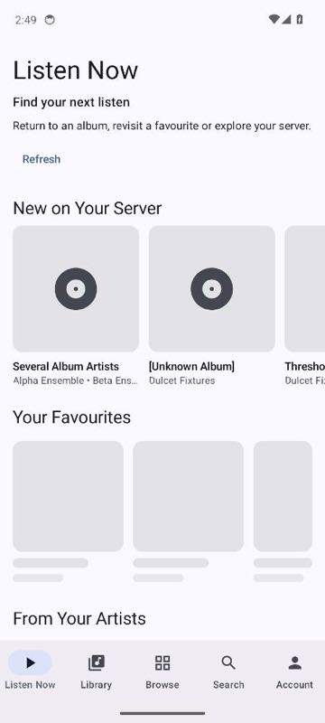
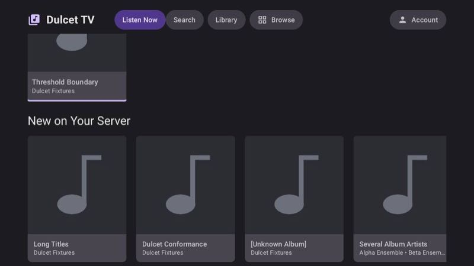
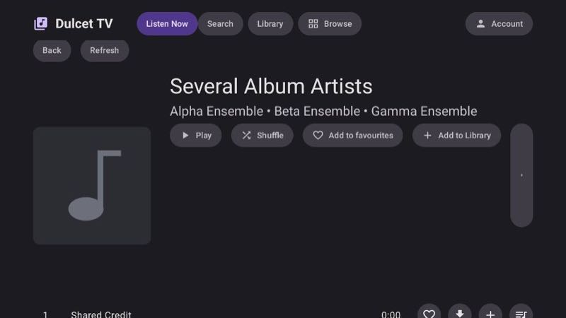
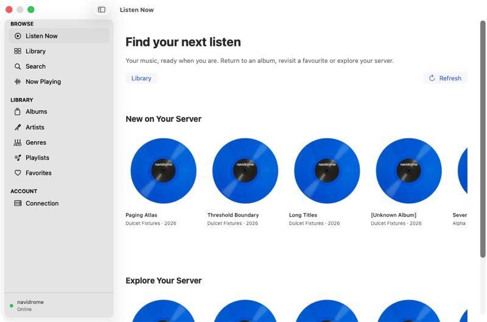
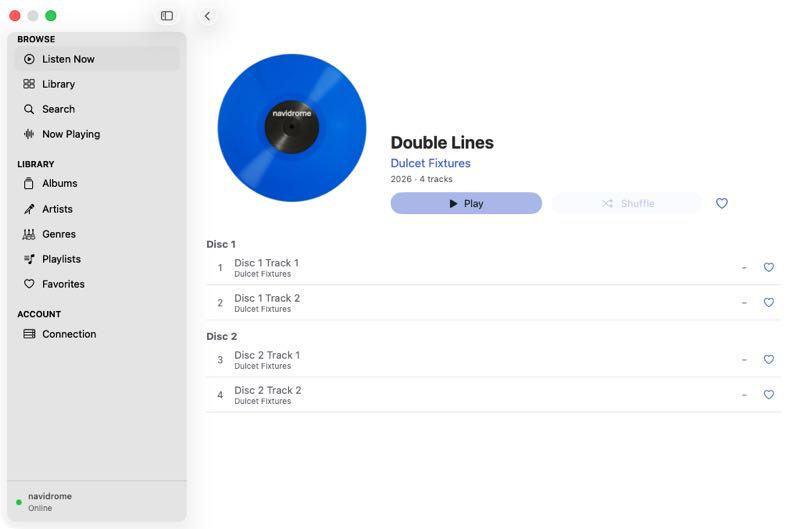
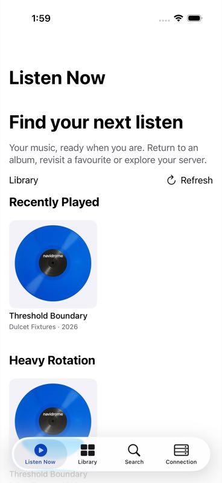
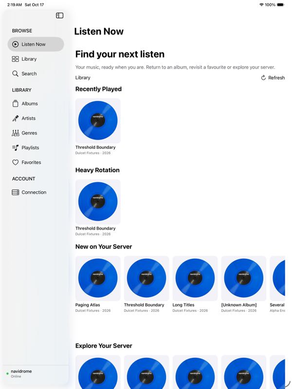
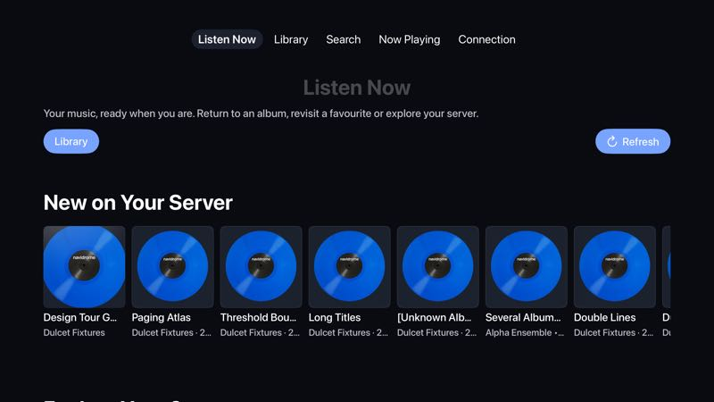

# Listen Now evidence and runtime checks

Listen Now is the first destination for a connected or saved account on iPhone, iPad, Mac,
Apple TV, Android phone and Android TV. First-run connection retains the existing account flow.
The feature remains `partial` in `FEATURES.yml` while the remaining native runtime gates and
player playlist-context integration complete. Compilation and shared tests are recorded separately
from each platform's UI execution.

## Shared and server behavior

- `HomeRecommendationsTest`: two server integration tests verify imported-style song plays,
  timestamps, stars and ratings; user and source visibility; real playlist play context;
  advertised REST/API equivalence; bounds, authentication, scopes and private ETag revalidation.
  The REST context control verifies submitted member plays, ignored private/unrelated contexts,
  no history from reads/now-playing, monotonic retry timestamps and API/REST deduplication.
  `ImporterTest/importsStarsRatingsPlaysAndPlaylistsThroughEachMatchingRoute` additionally
  imports the actual annotations and requires populated recent, frequent, daily and favourites
  shelves before any new local play; imported playlists alone do not manufacture listens.
- `ListenNowTest`: five shared reader tests verify cached home before relaunch network I/O,
  retaining it on discovery failure, playlist identity, ordinary REST fallback, and optional
  similar-song behavior. Similar-song seeds are representative songs from a recently played
  album; they do not claim song-level recency.
- `SuiteSelfTest`'s Home profile test accepts valid recommendations and rejects a deliberately
  duplicated item. The optional profile is documented as `DA-HOME-1`.
- `TvHomeLandingTest`: four Android TV host tests cover initial destination, Back navigation,
  focus route and Library access.
- `ListenNowTests/homeIsTheFirstDestinationAndQueriesUseTheCoreShelfSeam` checks the Apple
  destination order and ten public shelf queries. The full Apple package passed 332 tests
  serially before the copy-only localization pass.

Targeted commands (run Gradle through `tools/run-gradle-exclusive` on a shared development host):

```sh
tools/run-gradle-exclusive :server:test --tests '*HomeRecommendationsTest'
tools/run-gradle-exclusive :core:jvmTest --tests '*ListenNowTest'
tools/run-gradle-exclusive :dulcet-api-conformance:test --tests '*SuiteSelfTest.home profile*'
tools/run-gradle-exclusive :android:tv:testDebugUnitTest --tests '*TvHomeLandingTest'
swift test --package-path apple/DulcetKit --no-parallel
```

## Production UI controls

`ListenNowEmulatorProofTest/homeLaunchAlbumAndCachedRelaunch` runs the production Android
activity, account connector and library reader against a disposable server. It requires Home
selected at launch, scrolls to New on Your Server, opens a real album, recreates and relaunches
the activity, then reaches Library and returns Home. It runs on both emulator matrix entries
in `core-ci`. Its screenshots are written by `DesignTourShots` under the app's `design-tour`
external-files directory. Playback still uses the existing platform owner; this check does not
claim a new playback-engine contract.

`DulcetDesignTourUITests/testListenNowLaunchAlbumAndRelaunch` runs the corresponding iPhone
and iPad account/album/relaunch/tab control. `DulcetTVUITests`' method of the same name uses
the remote to focus Refresh and an album, selects the album, relaunches and returns through the
section bar. The iOS proof validates the expected device idiom when supplied by the runner.

The Mac design-tour `home` phase connects the production presentation/reader stack in its
hosted production root window, presses an album through accessibility and checks the reader
path, then returns through Library and Home. Its credential store is in memory, as in the
existing Mac design instrument. It does not claim signed Keychain persistence. Window capture
is attempted by the owning shell; any fallback is explicitly logged as a view render.

`tools/ci/run-home-proof` executes these controls inside the existing `apple-ci` disposable
fixture lifetime, after the relevant target has built. Each platform has its own result bundle,
execution guard and JUnit output. A workflow dispatch runs the native conformance legs; the
PR platform leg alone does not execute these fixture controls.

## Server selection and limits

Dulcet Server supplies ten shelves from per-user imported/live history and visible catalog:
recent albums, actual recent playlists, frequent albums, new albums, rediscovery, a daily mix,
favourites, artist and genre stations, and labelled catalog exploration. The shared public
`ListenNowShelf` / `LibraryQuery.ListenNow` seam uses the normal per-account reader cache and
request/offline rules. Apple and Android wrappers expose it to future system surfaces.

Plain OpenSubsonic uses recent/frequent/newest/random album lists, starred items and optional
similar songs. It hides unsupported rediscovery, daily mix, genre-profile and playlist-history
shelves. Discovery/auth/transport errors retain cached answers rather than silently replacing
them with an unpersonalized success. Continue Listening resumes the existing queue; album and
playlist tiles use the existing collection detail and playback actions.

## Run record

Merged `main` at `df546b2e` (scanner fix #332) into the feature branch without conflicts.
Main subsequently advanced to `fa2ec5e6` (trusted proxy fix #337). The merge retained both
spec revision records; the merged server compiled and all 18 selected Home/proxy tests passed.
On that product source, [core-ci 39014292891](https://github.com/legitimate-apps/dulcet/actions/runs/39014292891)
passed completely. Downloaded reports confirm **151 server cases and 60 API self-tests**, with
zero failures/errors/skips, plus four non-skipped Home device passes (phone/TV, plain/Dulcet).
On the merged product source, [core-ci 39000147383](https://github.com/legitimate-apps/dulcet/actions/runs/39000147383)
passed the full server step: **135 tests, zero failures/errors/skips**, including the three new
scanner regression/scale cases, both Home integration cases and the actual importer-to-Home
control. Its phone and TV device jobs passed; downloaded JUnit contains one non-skipped Home
case per platform/server (four total), against plain OpenSubsonic and advertised Dulcet Server.
The separate full native [run 39000146299](https://github.com/legitimate-apps/dulcet/actions/runs/39000146299)
checks the same merged Apple product source. Home JUnit reports now feed the required Apple
parity resolver using their actual test classes; the source policy and parity mutation/execution
self-tests pass locally.

Observed local core baseline: JVM 1,068 tests, Android host 1,259, native Mac 1,148, with no
failures, errors or skips. The five Home reader tests executed in each runtime. Shared iOS test
sources and phone/TV instrumented APKs compiled. Apple package tests passed 332/332 serially;
the localized Home package check passed 1/1. These establish shared logic and compilation,
not native UI execution.

| Control | Observed result | Evidence |
| --- | --- | --- |
| Android phone Home, plain REST | 1 passed, 0 skipped | [core-ci 38995786940](https://github.com/legitimate-apps/dulcet/actions/runs/38995786940), phone fallback XML |
| Android phone Home, Dulcet Server | 1 passed, 0 skipped | Same run, `listen-now-dulcet/results` XML; whole phone job passed |
| Android TV Home, plain REST | 1 passed, 0 skipped | Same run, TV fallback XML |
| Android TV Home, Dulcet Server | 1 passed, 0 skipped | Same run, `listen-now-dulcet/results` XML |
| Mac hosted production Home | 1 passed, 0 skipped; reached Home, album and return markers | [Apple run 38991471536](https://github.com/legitimate-apps/dulcet/actions/runs/38991471536), Mac Home JUnit and three screen captures |
| iPhone Home | 1 passed, 0 skipped; 35.622 seconds | [Apple run 38991471536](https://github.com/legitimate-apps/dulcet/actions/runs/38991471536), retained Home JUnit/xcresult |
| iPad Home | 1 passed, 0 skipped; 51.905 seconds | Same run, separate iPad Home JUnit/xcresult |
| Corrected Mac connection control | 1 passed, 0 skipped; 0.894 seconds | [Apple run 38995086942](https://github.com/legitimate-apps/dulcet/actions/runs/38995086942), connection-landing JUnit |
| Apple TV Home | 1 passed, 0 skipped; 16.433 seconds | Local leased Apple TV 4K, tvOS 26.5; `DulcetTVUITests/testListenNowLaunchAlbumAndRelaunch`, individual xcresult execution guard and JUnit passed |
| Full core/server/API and Android integration gate | Passed: server 132, API conformance 60, shared JVM/Android host 2,327, Android app host 1,753; zero failures/errors/skips | [core-ci 38995786940](https://github.com/legitimate-apps/dulcet/actions/runs/38995786940), actual JUnit case counts |

The full integration run above passed after legacy navigation controls were updated to enter
Library explicitly from the new Home destination. Its Home test retained all three photos for
each platform/server fixture, guarded by the host runner. The server's 132 cases include both
Home integration cases and the real importer-to-Home check; all 60 API conformance self-tests
passed, including the Home profile's duplicate-item negative control.

Host soaks all passed 20/20 repetitions: [production Library](https://github.com/legitimate-apps/dulcet/actions/runs/38988591007)
(two methods, 40 executions), [simple phone Search](https://github.com/legitimate-apps/dulcet/actions/runs/38991408220)
(one method, 20 executions), [production phone Search](https://github.com/legitimate-apps/dulcet/actions/runs/38992586654)
(one method, 20 executions), and [TV Home/Library/Search](https://github.com/legitimate-apps/dulcet/actions/runs/38992589407)
(ten methods, 200 executions). The remaining TV genre/sort/play/playlist controls passed
[20/20 repetitions](https://github.com/legitimate-apps/dulcet/actions/runs/38995783421)
(eight methods, 160 executions, zero skips). The production Search control continues to require device-only
one-character results, unique identities and remote canaries; Home may populate additional valid
cached catalog rows.

Local Android TV Home instrumentation also passed 1/1 in 39.724 seconds against a disposable
Dulcet Server. The committed Android photos are from the final hosted production Home controls
in run 38995786940: both phone and TV Home tests passed on both server types, with all three
photos retained per fixture. The phone header respects the status bar and hidden empty shelves
leave no extra vertical gaps. A photograph may show another shelf's loading placeholder while
the already populated New on Your Server shelf is usable.





Local Apple simulator enumeration stopped responding before UI execution; no shared runtime
restart or host reboot was performed. The local phone emulator produced system UI ANRs and was
stopped. Neither attempt counts as a successful UI proof. The first hosted native Home control
correctly failed on a header-only screen: an initially empty SwiftUI shelf never received its
reader appearance callback. Shelves now retain a concrete loading container; the retained
iPhone, iPad and Mac Home controls below observed populated content and album navigation.

The Mac Home test passed in 9.468 seconds using actual window captures (`capture=screen`). A later
legacy account-connection assertion expected Library and failed, so the whole native run is not
a green gate. Initial/saved/offline account controls now expect Listen Now; the explicit Library
cache/reconnect control still selects Library and requires it to stay there.

The replacement run's iPad My Library membership control failed before its Home step: its
helper checked See All before catalog publication and then swiped the sidebar while the target
remained offscreen in Browse's horizontal album row. The retained recording shows Browse
unchanged through those swipes. The helper now waits for See All and targets the album-page
scroll view. This navigation-driver correction still requires a native runtime rerun; Library
product code is unchanged. The separate light/dark/largest-text and ordinary-server controls
passed in the same iPad job.

That replacement run also passed Mac Home again (8.991 seconds, actual screen captures), the
corrected connection landing, all three My Library controls, reader cache/reconnect and quality/
lyrics controls. It then exposed a production root-navigation regression: choosing the catalog's
Playlists sidebar row while on Home changed the catalog section but left Home displayed, because
Home was counted as an active reader destination. Catalog sidebar choices now switch to Library
(or Browse on a Dulcet Server) before opening the chosen section root, preserving Home's own
navigation stack. `choosingACatalogSidebarSectionLeavesHomeAndKeepsItsOwnNavigationHistory`
covers this trigger and return path and passed locally (one actual test, zero failures).
The corrected `DulcetMacRatingsAndPlaylistsAppTest/everyPlaylistEditReachesTheServerThroughTheHostedMacApp`
also passed locally against a fresh disposable Navidrome fixture: **1 test, zero failures,
8.801 seconds**, verified in the individual xcresult and generated JUnit. Starting from Home,
the rendered Playlists sidebar reached create, album/track additions, removal, reordering,
rename, deletion confirmation and the deleted-elsewhere rename error; independent server reads
verified the mutations. The initial external-volume host launch blocked in `dyld` before tests;
staging the runnable products internally allowed execution, with build caches on the external
volume. Staging and fixture processes were removed after verification. The earlier failed whole
workflow is not reported as green.

Reviewed Mac proof images:




The earlier iPhone and iPad jobs were cancelled during later, unrelated controls. Their retained
Home JUnit files each contain one passing, non-skipped case; the whole workflow is not reported
as green. The screenshots below are from those completed Home controls.




The local Apple TV Home control drove Refresh and album focus, album activation, saved-account
relaunch, Library and the return to Home using the remote. Its current-source result passed
1/1 in 16.433 seconds on a leased tvOS 26.5 simulator.



## Native Library regression follow-up

On the current Apple product source, all four local iPhone My Library controls passed without
skips on iOS 26.5: largest-text Add (37.409 seconds), membership/offline replay (72.960),
light/dark/largest-text navigation (82.436), and ordinary-server navigation (9.225).
The compact helper enters Browse's Albums section; regular iPad/Mac use Recently Added's See All.
Individual xcresult execution guards required all four methods before JUnit emission.

The cold iPhone largest-text control in [run 39012368296](https://github.com/legitimate-apps/dulcet/actions/runs/39012368296)
then caught a readiness gap: the Browse tab existed and was tapped, but the retained failure
tree still showed Home selected. The other three My Library controls passed. The launch helper
now waits for a real album publication before navigating and asserts the compact tab's selected
state after its tap. On a fresh leased iPhone simulator, the corrected largest-text control
passed 1/1 in 43.588 seconds; the individual xcresult execution guard and JUnit both confirmed
the passing method. Hosted execution of that correction remains pending.

The corrected full iPhone suite then passed **4/4 without skips**: largest-text Add (44.376
seconds), membership/offline replay (83.653), appearance variants (88.077), and ordinary-server
navigation (10.495). The same shared readiness correction passed all three iPad controls
without skips: membership/offline replay (86.992), appearance variants (72.178), and
ordinary-server navigation (9.000). Both used fresh leased iOS 26.5 simulators and disposable
loopback fixtures; individual xcresult execution guards required every method before JUnit
was accepted. An initial iPad retry stopped at the fixture port preflight before UI and is
not included in these passing counts.

The TV helper now enters Browse's visible Albums section before finding a named album; the
horizontal Browse shelf does not instantiate offscreen cards. The light/dark/largest-text
control passed in 53.667 seconds and ordinary-server navigation in 6.861 seconds. Its membership
control reaches the correct focused album but remains unverified: on local tvOS 26.5, real
1.5- and 3-second remote holds left the native menu closed, so the Add to Library assertion
failed. The driver retains that assertion and the independent membership/offline checks.
No Library product implementation was changed for these navigation-driver corrections.

The hosted iPad job in [run 39002864991](https://github.com/legitimate-apps/dulcet/actions/runs/39002864991)
failed before UI execution when its disposable Navidrome readiness check timed out during the
initial scan. It supplies no iPad driver result. Local iPad verification then passed all three controls on iOS 26.5, without skips:
membership/offline replay (100.973 seconds), light/dark/largest-text navigation (65.682),
and ordinary-server navigation (9.237). The individual xcresult execution guard required all
three methods before JUnit emission. The local compiler was Xcode 27; hosted CI selects Xcode
26.4.1. A failed hosted fixture setup is not counted as a passing control.

## Integration boundary

Server playlist recency accepts actual API play contexts and optional submitted REST scrobble
contexts (`dulcetContextType=playlist`, `dulcetContextId`) advertised by `dulcetHome` v1.
The current player must carry its real playlist source through the durable submitted-play outbox
and transport before these REST contexts can populate from app listens. That player integration
belongs to the separate player-session change. The Home UI does not infer playlist listening
from fetching or editing playlists. Continue Listening uses the existing saved queue independently.
