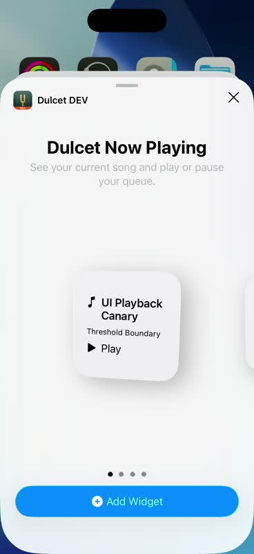
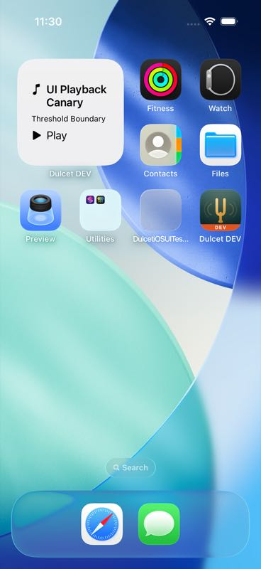
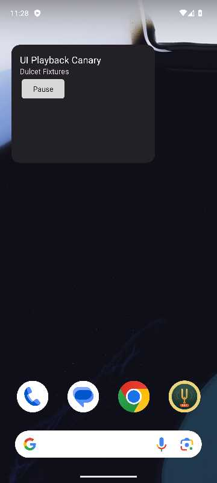

# System surfaces — implementation and evidence boundary

2026-10-16. Source implementation is partial until each platform's actual OS trigger reaches the
existing player. A compile result, a router unit test, and a direct intent invocation prove different
links; none alone proves Siri, WidgetKit, CarPlay, Android Auto or Assistant delivery.

## Ownership and data

Apple entry points use `DulcetSystemActions`, the existing production presentation store and its
account-bound reader. They close request subscriptions, reject account-generation changes, preserve
opaque IDs and surface unavailable/ambiguous results. An explicit action can reconnect saved
credentials while backgrounded. The existing `DulcetSystemMediaControls` remains the Now Playing
publisher and remote-command owner. CarPlay queue actions use existing queue entry IDs.

Widget App Groups contain only display metadata, timestamps and opaque song/provider references.
They have separate DEV/PROD containers and do not share credentials, Keychain access groups or reader
databases. Recently Played is device-local, clears on account change, and survives host relaunch.
Recent song buttons resolve the stored provider/ID through the current reader before playing.
The Apple Pinned widget projects at most four metadata entries from the shared `.pinned` reader
window and shows at most three buttons. It filters by current account and accepted pin membership;
a stale button rechecks opaque kind/provider/ID and membership before playing. Account changes and
unpins remove the projection. Snapshots written before the pinned field was added remain readable.
`systemSurfacePinsProjectOnlyCurrentAccountMetadataAndRemoveUnpinnedItems` and
`systemSurfacePinnedReplayRevalidatesOpaqueIdentityAndRejectsAnUnpin` cover these boundaries.
Pinned widget rendering/interaction in the OS host is not yet claimed; Android pins remain deferred.

Android uses its existing playback service/controller, promoted to `MediaLibraryService`; trusted
system or same-app controllers receive library commands. Media IDs contain opaque references, never
stream URLs or credentials. Issued-item validation and the active account gate precede `playQueue`.
The phone widget sends explicit PendingIntents to that session and stores only display metadata in
private app preferences. TV keeps the shared session/Now Playing behavior without a home widget or
car launcher declaration.

## Signing and activation

| Platform/channel | Extension ID | App Group | Distribution profile |
|---|---|---|---|
| iOS DEV | com.legitimateapps.dulcet.dev.widgets | group.com.legitimateapps.dulcet.dev | Dulcet CI Dev iOS Widgets App Store |
| iOS PROD | com.legitimateapps.dulcet.widgets | group.com.legitimateapps.dulcet | Dulcet CI iOS Widgets App Store |
| macOS DEV | com.legitimateapps.dulcet.dev.widgets | group.com.legitimateapps.dulcet.dev | Dulcet CI Mac Dev Widgets App Store |
| macOS PROD | com.legitimateapps.dulcet.widgets | group.com.legitimateapps.dulcet | Dulcet CI Mac Widgets App Store |

Register both groups, associate the correct group with each channel's host and extension ID, and
refresh host profiles. On macOS 15+, the recommended `group.` identifiers also require
profile authorization; see [Accessing app group containers](https://developer.apple.com/documentation/xcode/accessing-app-group-containers).
CI imports optional base64 profiles from
`DULCET_DEV_IOS_WIDGETS_PROFILE_BASE64`, `DULCET_IOS_WIDGETS_PROFILE_BASE64`,
`DULCET_DEV_MAC_WIDGETS_PROFILE_BASE64`, `DULCET_MAC_WIDGETS_PROFILE_BASE64` using the existing
temporary-keychain lifecycle. The archive/export map signs the embedded extension using its own
profile. Missing extension profiles fail signing; this change does not create portal resources or
pretend current profiles already include the new capability.

CarPlay's managed capability is separate. Apple's [CarPlay Simulator instructions](https://developer.apple.com/documentation/carplay/using-the-carplay-simulator)
say the app needs the appropriate entitlement to appear in the simulated car. Simulator builds
therefore request `com.apple.developer.carplay-audio` in Xcode’s simulated entitlements. Device archives
use `tools/release/carplay-entitlements`: only a named selected host profile with the expected
team/channel application identifier and `carplay-audio=true` enables the audio key. Before Apple's
grant, the device app omits it; after the grant, refresh both DEV and PROD host profiles and the next
archive activates it. The grant cannot change an already installed signed app. These alternate
entitlements must equal the base channel App Group plus only the audio key, enforced by release
policy. Widget entitlements are fixed and cannot inherit the host selector. Hosts and extensions inherit a
nonempty default build number for local installation; release automation overrides that setting for
all targets together.

OBSERVED on Xcode 27 / iOS 26.5: the host installed and played the disposable canary without a
provisioned CarPlay profile. Its generated `-Simulated.xcent` contained the audio key and the DEV
App Group. This establishes installation with simulator entitlements, not a CarPlay display.
Device Hub did not yield a controllable CarPlay simulator window: its UI automation requests timed
out. The installed plugin requires a USB-connected physical iPhone, and Apple’s Developer Tools
Engineer [explicitly confirms that Device Hub does not support simulator CarPlay connections](https://developer.apple.com/forums/thread/834440).
The independently checked local tool inventory has no classic Simulator app or older Xcode.
Consequently no CPTemplate browse, selection, Now Playing or queue action is claimed as exercised.
A compatible classic Simulator toolchain, or the separately provisioned physical-device path, is
needed for that remaining proof. The ordinary iOS simulator’s successful installation does not
establish an entitlement exception for physical devices.

## Verification record (2026-10-16 baseline)

- OBSERVED: final Swift system-surface regressions passed 6/6, including cold background reconnect,
  short-name recent replay and continuation past the first page. A serial full package run passed
  337/337 with zero issues (`swift test --no-parallel`).
- OBSERVED: final generic iOS (universal iPhone/iPad), macOS and tvOS builds passed with Xcode 27.
  Explicit iPad builds and both iOS/macOS PROD builds also passed. iOS and macOS widget extensions
  and WidgetKit previews compiled. Final Android DEV/PROD phone, instrumentation APK and Android TV
  builds passed; the core library-window JVM suite passed 14/14, including fresh shuffle. After the real widget fix, the full
  DEV host suite passed 206/206; PROD ownership/account-change regressions passed 4/4.
- OBSERVED: after tightening controller authorization to Media3's UID trust result, the production
  session/browser ownership regressions passed 3/3 and account-change regression passed 1/1 in
  each of DEV and PROD. An untrusted controller claiming the app package is rejected.
- OBSERVED: hosted Android emulator run [38996882165](https://github.com/legitimate-apps/dulcet/actions/runs/38996882165)
  executed `AndroidEmulatorSystemSurfacesProofTest/mediaBrowserSearchSelectionStartsTheExistingPlayer`
  successfully (10.393 seconds, no skip). A real Binder `MediaBrowser` connected to the production
  service, browsed/subscribed to four folders, searched and selected the disposable playback
  canary, and verified the existing player's raw song ID, advancing media time and pause/resume.
  The client uses the app UID. This proves the production MediaLibraryService Binder path;
  Android Auto host discovery, its separate UID trust classification, DHU UI delivery and
  Assistant voice delivery remain unproven. The shipped FEATURES cell is limited to the
  service browse/search/playback contract for clients, not those host integration claims.
- OBSERVED: hosted account-change soak [38996252392](https://github.com/legitimate-apps/dulcet/actions/runs/38996252392)
  reported `SOAK RESULT passed=20 failed=0`. The earlier two-case ownership soak
  [38994897664](https://github.com/legitimate-apps/dulcet/actions/runs/38994897664) also passed 20/20;
  the expanded three-case authorization/ownership soak
  [38996884979](https://github.com/legitimate-apps/dulcet/actions/runs/38996884979)
  also reported `SOAK RESULT passed=20 failed=0`.
- OBSERVED: 4/4 provisioning selector tests passed; pinned XcodeGen 2.46.0 regeneration/self-test
  matched; release and string policies passed. `tools/test-release-channel` passed 371 assertions,
  rejected all 117 policy mutations, and passed 37 bundle validations.
- OBSERVED: the initial parallel Swift run reported 26 issues: 22 search deadline assertions,
  three account-cleanup timing assertions and one AVPlayer readiness assertion. Search code and
  those tests are unchanged from main. The serial final run passed all cases. An independent
  unchanged-main parallel control ran 331 tests: search cases passed in 3.5–3.7 seconds, while an
  old AVPlayer global Now Playing title assertion failed. The earlier loaded search run exceeded
  its five-second MainActor deadline. These observations support load/parallel-test contention,
  rather than a system-surface search regression; the precise scheduling cause is inferred.
- OBSERVED: the iOS 26.5 real WidgetKit picker rendered the production Now Playing view with
  `UI Playback Canary`, its album subtitle and Play control. A retained XCUITest screenshot and
  recording establish the live shared-container projection. The remote picker omitted its AX
  controls; an observed-layout fallback allowed the Home installation to complete in the next run.
- OBSERVED: `DulcetSystemSurfacesUITests/testHomeWidgetRendersAndItsIntentResumesPlayback`
  passed on iOS 26.5: one case, zero failures, 63.444 seconds. It installed the real Home widget,
  verified the canary title, tapped Resume and observed the existing player's media clock advance
  from `0:11` to `0:12`. This is an actual WidgetKit-to-AudioPlaybackIntent-to-player proof,
  distinct from the named Siri intent path. The retained Home screenshot was inspected.
- OBSERVED: Siri was invoked through `XCUIDevice.siriService`; the simulator displayed
  “Siri Not Available — Data for using Siri is downloading.” No Siri playback succeeded.
  Native macOS AppIntentsTesting execution was attempted through XCUITest, but the local runner
  failed before executing any case: “Timed out while enabling automation mode.” Developer mode
  was enabled; the UI automation authentication step remained unavailable to this harness.
  The iOS runtime cannot load Xcode 27's AppIntentsTesting dependency, so that import is macOS-only.
- OBSERVED: local Android API 34 launcher proof passed `OK (1 test)` in 21.228 seconds with
  `dulcetSystemWidgetProof=true`. The real Binder client verified advancing media time and the
  receiver broadcast; the launcher pinned the production widget, rendered the visible canary and
  delivered its Pause PendingIntent to the existing player. The retained compressed image was
  inspected. The first run exposed `ReceiverCallNotAllowedException` because the widget used a
  receiver-restricted context to bind; using the application context fixed that exact trigger.
  The regular CI path now sends the real receiver broadcast and asserts the pause effect too.
- PENDING: named Siri/Shortcuts intent delivery, macOS/iPad widget hosting, Recently Played and
  Lock Screen/ControlWidget OS interaction, CarPlay display/selection and final-head hosted conformance. No physical device, portal
  capability grant, archive upload or release is claimed.

## Scope limitations

Catalog name matching is exact, case/diacritic insensitive, and rejects duplicates rather than
choosing an arbitrary edition. Names shorter than two characters can match only the device cache,
matching the reader's server-search minimum. Recent replay uses the stored identity even for such
titles. Shortcut discovery provides Spotlight entry points; catalog-wide
Spotlight indexing is deferred. CarPlay has Library, Playlists, Recently Played and Queue tabs;
search by voice uses App Intents. Widgets provide play/pause and recent songs; no separate player is
created. ControlWidget requires iOS18+. Catalog shuffle asks OpenSubsonic for a fresh sample of up to
500 songs; Dulcet Server My Library shuffles the owned-song projection. Large browse lists use
explicit continuation folders rather than relying on Android Auto request pagination.

## Retained OS-host images

The iOS images are the real WidgetKit picker and Home host (live production snapshot); the Android
image is the launcher Home host before its Pause action. Both use only the published disposable corpus.

## Integration UI assertion correction (2026-10-17)

The full Apple run [39021621257](https://github.com/legitimate-apps/dulcet/actions/runs/39021621257)
passed its Mac library browse proof but failed the merged offline-pin heading query and the
grouped-search count read. OBSERVED: the retained recording at 23 seconds shows Pinned and
Threshold Boundary after offline relaunch; the failure hierarchy contains the exact heading
identifier. The search recording shows Artists and 1 result while the label-only assertion read
an empty string. These failures do not establish lost pin data or an incorrect search count.
The shared UI selector now resolves exact identifiers from bound static-text elements and reads
AXValue when AXLabel is empty, retaining both content assertions and their bounded waits.

OBSERVED follow-up: run [39028026485](https://github.com/legitimate-apps/dulcet/actions/runs/39028026485)
executed all five Mac My Library UI cases with zero failures in 223.524 seconds, including the
Pinned heading and selected Artists count. Later inherited proof failures were separate:

- The offline iPhone relaunch hierarchy puts Recently Added below the viewport at y=900.3,
  after the new Library destinations and connection notice. The proof now scrolls to the lazy
  album grid before requiring the same persisted opaque album identity and absent server write.
- At the largest text size, six real swipes reached only the third fixture album. The phone
  album-opening loop permits up to twenty swipes and still requires the exact target to exist
  and be hittable before activation; Mac/iPad bounds remain unchanged.
- The iPad app-host offline control returned request timeout (-1001) under its 0.5-second limit.
  It now allows five seconds for URLSession initialization but still requires an actual
  `NSURLErrorCannotConnectToHost` (-1004); timeouts cannot satisfy the offline proof.

These changes adjust proof navigation/setup and do not change production behavior. The final
hosted runtime results remain necessary to verify them.

## 2026-10-18 integration with published Apple conformance repairs

The merge carries main's `02a158f6` repairs without replacing system-surface ownership. Its
verified gain writes, stable Now Playing Close host, positive catalog/history/native-menu
controls, television first-row realization and named-fixture preparation supersede the earlier
integration setup variants recorded above. The original dated results remain historical;
stronger OS-host verification is still bounded by the surface table.

- OBSERVED: the merged full Swift package passes **356/356**, zero skips/failures/errors,
  in **102.769 seconds** of test execution. Its timeline contains 356 starts and 356 completions,
  with at most one logical test active. All **68 LibraryReader tests** pass, including background
  reconnect, opaque recent-song replay, continuation and both pinned projection/replay cases.
- OBSERVED: `DulcetSystemSurfacesUITests/testHomeWidgetRendersAndItsIntentResumesPlayback`
  passes against the merged app on iOS 26.5: **one case, 56.369 seconds**, zero issues.
  The real Home widget renders the named song and delivers Resume through its App Intent to
  advancing playback in the existing player.
- OBSERVED: the account-state helper distinguishes a zero-height/offscreen retained accessibility
  keyboard from a visible one. Twenty-one extracted credential/dismissal controls pass; replaying
  `819b3a2a` rejects its captured offscreen Hide tap. The complete real account-state flow passes
  on iPad (**238.418 seconds**) and iPhone (**256.441 seconds**), one case each with zero issues.
  That helper and its controls are unchanged by the subsequent main merge.
- OBSERVED: XcodeGen **2.46.0** regeneration produces no project difference; the regeneration
  self-test, parity (27 feature rows), CI policy, OS-floor configuration and release policy pass.
  Hosted final-source results are reported on [PR #333](https://github.com/legitimate-apps/dulcet/pull/333).

No system-surfaces FEATURES cell is promoted by these integration results. Named Siri, additional
widget hosts/accessories/ControlWidget, CarPlay template-host delivery and external Android Auto
or Assistant delivery retain their previously stated limits.
